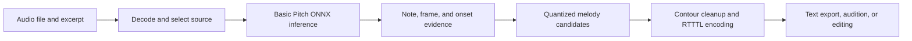

# Architecture

MP3 to RTTTL Studio separates expensive audio inference from inexpensive melody
rendering. The command-line interface performs both stages in one operation, while the
desktop studio retains analysis results so a user can explore many interpretations
without repeatedly running the model.

## Runtime data flow

The model output is evidence rather than the final melody. The decoder must choose one
voice, decide when pitches truly change, compact octave jumps, and express durations
using RTTTL's limited notation.

## Core converter

`mp3_to_rtttl.py` owns the analysis and rendering pipeline.

### Dependency loading

Audio dependencies are loaded on demand so basic argument parsing and source
inspection remain lightweight. Basic Pitch may install Core ML or TensorFlow-related
packages transitively on some platforms, but the application deliberately selects the
bundled `nmp.onnx` model and executes it with `onnxruntime`. A process-level lock
protects dependency/model initialization, and inference is serialized through a
separate transcription lock.

### Analysis stage

`analyze_audio()` performs the expensive work:

1. Decode the requested excerpt to a consistent sample rate.
2. Choose the full mix, harmonic content, or an automatically selected source.
3. Estimate tempo with a lightweight spectral-flux calculation unless BPM is supplied.
4. Run Basic Pitch once to obtain note events, frame confidence, and onset evidence.
5. Return an immutable `TranscriptionAnalysis` value containing the reusable evidence.

No network service participates in this stage.

### Rendering stage

`render_analysis()` converts cached evidence into a candidate ringtone:

1. Quantize event overlap and attack evidence to a 16th- or 32nd-note grid.
2. Select a predominant line using the configured event or salience-contour decoder.
3. Balance attack evidence, continuity, jump costs, lead preference, and sustain.
4. Merge incidental runs and optionally smooth octave discontinuities.
5. Collapse repeated frames, decompose durations, and encode legal RTTTL tokens.
6. Score the result against the source evidence for candidate ranking.

`convert()` is the CLI-oriented orchestration layer that analyzes, renders, writes
optional MIDI diagnostics, and returns the RTTTL string.

## Unified browser studio

`rtttl_studio.py` serves the sibling `rtttl-generative-transformer/web/dist` build and
a bounded same-origin conversion API. `--build-web` runs that project's existing
build with a root asset path. The browser's existing generator, cache, player,
library and exports remain the common workspace.

Audio uploads are limited to 32 MiB and excerpts to 30 seconds. One background
conversion runs at a time. It calls `analyze_audio()` once, renders up to three
distinct interpretations with different decoders, then discards the source file.
Eight recent jobs at most remain in memory for 15 minutes. The HTTP service binds
only to loopback, validates Host/Origin and uses no additional web framework.

The browser imports conversion results as RTTTL, preserves old library entries,
and edits into new versions. Explicit continuation tokenizes the selected score
as the transformer's prompt, preserving its events and tempo. Generation is not
part of transcription ranking or automatic correction. See
[the API contract](docs/STUDIO_API.md) and [feature specification](docs/RTTTL_STUDIO_SPEC.md).

## Desktop studio

`mp3_to_rtttl_gui.py` contains the PySide6 application.

### Preview and selection

The studio first builds a low-rate waveform preview. FFmpeg is used when available;
librosa is the fallback. The preview is separate from the quality-preserving decode
used for transcription.

### Background work

Long-running preview and inference operations run through `QRunnable` workers on
Qt's global thread pool. Workers report progress and deliver results through signals.
Request identifiers prevent an obsolete background result from replacing state after
the user has selected a different file or excerpt.

### Analysis cache

The GUI retains an in-memory least-recently-used cache of four analyses. A key includes
the resolved source path, modification time, excerpt start and duration, and source
mode. Controls that affect only rendering can reuse this analysis; changing the source
selection or analysis mode creates a different key. Nothing is persisted after exit.

### Variations and ranking

`variation_profiles()` builds a larger candidate pool around the chosen detail,
continuity, lead preference, spread, and grid settings. `rank_variations()` removes
exact duplicates and combines source-match score with pitch-class diversity. The GUI
requests 9, 12, or 15 final versions, but may return fewer when candidates are
duplicates or cannot be rendered.

### Audition and editing

`AudioPlayer` uses Qt Multimedia for source playback and writes synthesized ringtone
samples to temporary WAV files for audition. Those files are deleted when the studio
closes. The waveform and piano-roll widgets map transport time, RTTTL tokens, and model
evidence so playback and edits remain synchronized.

## Shared RTTTL utilities

`rtttl_utils.py` supplies the small shared data model and operations used by the GUI,
converter, verifier, and tests:

- parse an RTTTL string into timed tokens;
- expand tokens to grid frames for comparison; and
- synthesize a simple square-wave audition signal.

Keeping these operations independent of Qt prevents the GUI from becoming the only
way to validate an RTTTL result.

## Verification layers

The repository uses three verification levels:

1. **Lightweight CI** runs Ruff, unit tests, and syntax compilation with only NumPy and
   Ruff installed. It performs no model inference and uses no audio assets.
2. **Synthetic quality gate** runs `tools/evaluate_rtttl_quality.py` in a full runtime
   environment. It synthesizes known melodies in a temporary directory and checks the
   end-to-end transcription and rendering path.
3. **Optional real-excerpt evaluation** accepts repeatable
   `--real-excerpt NAME PATH START DURATION` arguments. These files remain local and
   must be supplied by the user.

`--write-audition-dir` can accompany private real-excerpt checks to create listening
artifacts. The output directory and all source recordings are outside the source
boundary and must not be committed without redistribution rights.

## Repository boundaries

- Source control contains code, documentation, text fixtures, and dependency metadata.
- User audio, commercial recordings, model-generated audition packs, virtual
  environments, caches, MIDI diagnostics, and normal ringtone output are local
  artifacts.
- The application does not require a server, account, API key, or cloud transcription
  service.
- `requirements.txt` defines compatible installs; `requirements.lock` captures the
  exact Python 3.11 dependency resolution used for reproducibility.

## Safe extension points

- Add a melody decoder behind `MelodySettings` and `render_analysis()` rather than
  coupling it to GUI controls.
- Add GUI variation profiles without rerunning analysis when they use existing model
  evidence.
- Add parser or renderer behavior with lightweight unit tests in `tests/`.
- Add quality cases as generated or clearly redistributable fixtures. Never make a
  private recording a required test input.

Changes to decoder defaults should pass both the lightweight tests and the synthetic
quality gate. Listening checks are valuable additional evidence, but should not make
the public build depend on copyrighted audio.
